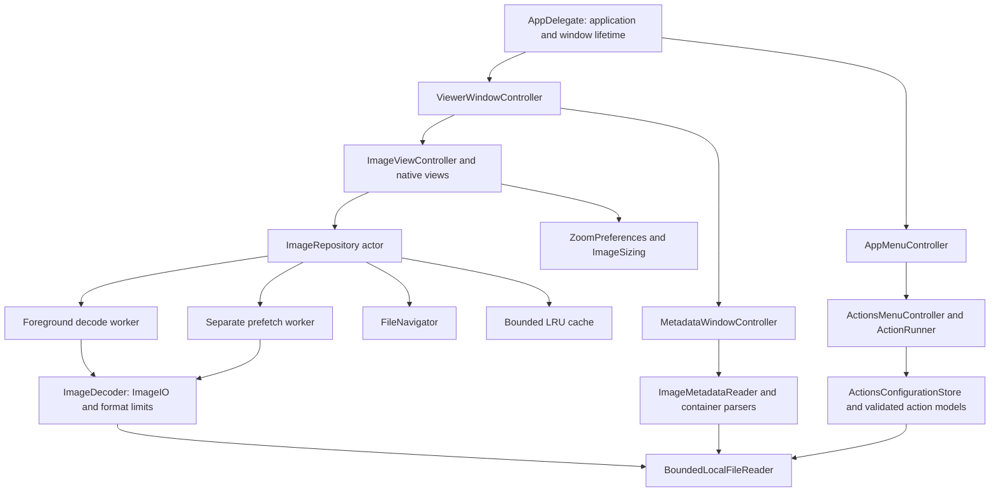

# Glimpse architecture review and code audit

Reviewed 2026-11-04. Application changes through `e994170`; development tooling and packaging through `df45f3f`. This is a source review with automated and local interactive validation, not an independent penetration test or security certification.

## Assessment

The resulting architecture is appropriate for a small native image viewer. Application lifecycle, AppKit presentation and reusable services have explicit ownership and dependency boundaries. File I/O and decoding no longer block the main actor, geometry and navigation are independently testable, and image caching has bounded retention and invalidation. No unresolved critical/high-severity application issue was identified in the reviewed paths. The remaining trust and resource limitations below matter for public distribution.

Avoid adding another framework for every feature. Keep UI policy in the app, move reusable rules and I/O into focused services, and keep dependencies flowing from the app into core. A sandboxed or multi-process edition would be a separate design change.

## Responsibilities and ownership

| Area | Responsibility | Boundary |
| --- | --- | --- |
| `Glimpse/Sources/App` | Lifecycle, window collection, menus, preference callbacks | No decoding or metadata parsing |
| `Glimpse/Sources/Viewer` | Window/toolbar, rendering, keyboard/gesture handling, presentation | Main actor; request IDs prevent stale completion |
| `Glimpse/Sources/Actions` | Menu/editor controls, user confirmation, native command/URL execution | Configuration data never executes inside core |
| `Glimpse/Sources/Metadata` | Searchable inspector, copy/export to clipboard | Parsing runs in a separate core actor |
| `GlimpseCore/Sources` | Preferences, pure layout, navigation, validated file reads, decoding/cache, actions JSON, metadata | No windows, menus or application lifecycle; uses Apple platform image APIs |
| `Tests/GlimpseCoreTests` | Behavioral, malformed-input, cancellation, cache and configuration checks | Same core source files as the shipping app |

Xcode builds GlimpseCore as a static framework. A small Swift package compiles those same sources for unit tests; it is not another implementation or a runtime dependency. There are no third-party runtime packages. Explicitly main-actor UI types own cancellable tasks and release window/metadata/notification resources on close. Repository/cache state belongs to actors. The limited `@unchecked Sendable` image wrappers rely on immutable raster references after decoding and main-actor presentation; animated mutable images are excluded from cache reuse. Preserve that contract when extending imaging.

## Findings fixed

| Finding | Impact | Resolution |
| --- | --- | --- |
| Synchronous image work and speculative work competing with foreground loads | UI stalls and navigation latency | Separate foreground/background decode actors, cancellation and current-request checks |
| Repeated decode on navigation | Avoidable latency | Per-window LRU; prefetch up to two directional neighbors; tests verify reuse |
| Stale files/pending prefetch could be reused after edits | Incorrect image display | Device/inode/size/nanosecond-mtime fingerprint, checked before reuse/insertion; race regression test |
| Unbounded file/image processing | Excessive resource use, blocking on special files | One validated regular-file descriptor; nonblocking open, bounded chunk reads; encoded/pixel/frame/estimated decoded limits |
| Unbounded metadata output/comments | Excessive allocations and UI work | Bounded parsers, per-value and aggregate display limits, row/depth/frame caps and cancellation |
| EXIF orientation dependent on rendering context | Incorrect rotation or decode failure | ImageIO orientation transform at original maximum edge; regression fixtures |
| Window/controller/observer lifetime and reopen timing | Leaked work or duplicate picker behavior | Explicit close callbacks, task cancellation, RAII notification registration, deferred-open state check |
| Toolbar delegate attached after toolbar | Zoom icons missing | Configure delegate before window attachment; verified in installed app |
| Ad hoc command-string substitution | Filenames potentially interpreted as executable code | Separate executable/argument fields; one-pass literal substitution; common inline interpreters rejected, including resolved executable aliases |
| URL template substitution could change URL structure | Filename data affecting destination/query structure | Fixed HTTPS host/no credentials, percent-encoded placeholders, confirmation before sharing file information |
| Broken/oversized actions config could lose customization on reset | Data loss | Validate before choosing; stage replacement and rename original to unique backup; restore on replacement failure |
| Invalid/empty JSON could remove editing access | User locked out of recovery | Management controls are unconditional; invalid actions are disabled |
| Build output pipeline could obscure command failure | False successful CI results | `set -euo pipefail`, direct xcodebuild exit status, strict builds and tests |
| Public distribution instructions referenced unavailable releases/tools; declared license text absent | Misleading installation path and incomplete packaging | Accurate build/distribution guide, declared GPLv3 text, universal signed/notarized packaging workflow |

## Verification completed

- **59 tests passed**, zero failures, with generated JPEG/PNG/GIF fixtures, EXIF orientation/comments, navigation aliases/wrap/hidden files, persisted zoom settings, cancellation/off-main-thread decode, cache budgets/invalidation and stale prefetch races.
- Parser checks cover **every truncated prefix** of representative PNG/JPEG/GIF fixtures and **1,000 deterministic malformed inputs**, plus metadata comment flooding and display budgets. This is useful regression coverage, not a comprehensive fuzzing campaign.
- Actions tests cover defaults, invalid JSON, limits, backups/reset, literal placeholder text inside filenames, URL encoding, control characters, common inline interpreter rejection and trusted script arguments.
- **Debug and Release builds passed** with complete Swift concurrency diagnostics and Swift warnings treated as errors, using Apple Swift 6.2.4/Xcode on this Mac. Compatibility with the minimum claimed Xcode version was not independently tested.
- **Universal Release packaging passed**: arm64 and x86_64 verified with lipo; ad-hoc hardened-runtime signature passed strict codesign verification; archive/checksum produced. Public mode correctly refuses missing Developer ID/notary settings. The Apple upload/stapling/Gatekeeper steps await credentials and remain unexecuted.
- Installed universal app at `~/Applications/Glimpse.app`; binary and icon hashes match the signed build. Interactive checks opened the user's JPEG, navigated to/from a WebP, verified zoom keyboard shortcuts and toolbar actions, opened the metadata inspector and filtered JPEG quantization data, and opened the default actions JSON in TextEdit through the permanent menu item.
- Gitleaks **8.30.1**, official release archive verified against the pinned checksum: history scan passed with no detected secrets. The final scan result is retained with local validation logs. CodeQL workflows are configured for Swift and GitHub Actions but have **not run on GitHub**; private repository eligibility is not established.
- **AddressSanitizer did not complete.** The instrumented test target compiled, but the runner stalled before test output. Direct XCTest initially reported late sanitizer interception; preloading the runtime removed that diagnostic but the runner still timed out. No sanitizer-clean result is claimed. Rerun in a normal local terminal or dedicated macOS CI environment and investigate startup before relying on it.

One generated 2048×1536 JPEG sample measured **11.93 ms cold / 0.11 ms warm** and reused the same cached image object. This validates the cache path, not a general benchmark. Actual speed depends on file size/format/storage and whether the neighbor finished preloading. Adjacent preloading/caching is also used by [qView](https://github.com/jurplel/qView/releases) and [nomacs](https://nomacs.org/docs/getting-started/introduction/).

## Remaining limits and release work

1. **Public trust is not configured yet.** This Mac has Apple Development signing only. Obtain a Developer ID Application certificate/private key and configure a local notarization keychain profile. Then run the public release script and test the actual quarantined browser download on a clean Mac. See [Distribution](DISTRIBUTION.md). The installed local copy is ad-hoc signed and is not the public trusted build.
2. **No process isolation for native image codecs.** File bytes default to 256 MB; each frame is limited to 100 million pixels/512 MB estimated decoded storage, at most 1,000 frames and 200 million aggregate frame pixels. These checks reduce abuse; ImageIO/NSImage allocations and codec behavior remain native platform trust. Decoder cancellation is checked between operations, not inside a blocked native call.
3. **App Sandbox is disabled.** Hardened runtime is enabled. Arbitrary configured commands intentionally have user privileges and can modify files/use the network after confirmation. Argument arrays and inline-code checks prevent common mistakes but cannot make arbitrary scripts/wrappers safe. Direct-child termination is best effort; child process trees are not forcibly contained.
4. **Memory estimates are per window.** Default LRU retention is three images/256 MB estimated decoded bytes, excluding current display, encoded input, codec working memory and in-flight foreground/prefetch. Multiple windows multiply resource use. GIF/TIFF speculative loads are skipped; mutable animated representations are not cached. A future shared cache/memory-pressure policy may help very large collections.
5. **Metadata is bounded and decoder-dependent.** The inspector lists exposed ImageIO fields plus supported container details, including EXIF when present. Private vendor blocks or metadata not exposed by ImageIO may be absent. Values over 16 KB and reports over the display/row/frame budgets are truncated with notices. GIF counts describe palette entries, not counted unique pixel colors; JPEG quantization tables are reported without inventing an exact encoder quality percentage.
6. **Cache fingerprints are not content hashes.** Ordinary edits/replacements invalidate; deliberately restoring inode/size/mtime or unusual filesystem behavior can defeat this heuristic. Directory membership is captured on initial open; reopening refreshes newly added/deleted siblings.
7. **Release matrix still needs testing.** Intel code is built, not executed here. Older supported macOS versions, clean-machine notarized first/offline launch and accessibility/VoiceOver need broader release QA. CodeQL execution and the incomplete sanitizer check remain follow-up validation, not successful scans.

## Focused commits

- `e15e6e2` — app/core architecture separation.
- `ef1f9b5` — asynchronous loading, bounded file/image handling and window lifetime fixes.
- `f92cf47` — configurable Actions menu, editing and reset controls.
- `b01c664` — metadata inspector and container details.
- `3b0b0e4` — bounded adjacent-image preload/cache.
- `e994170` — metadata budgets, command/config hardening and regression tests.
- `5ca1804` — tests/strict builds, pinned secret scanner and optional CodeQL.
- `df45f3f` — universal release packaging, declared license and user/developer documentation.
