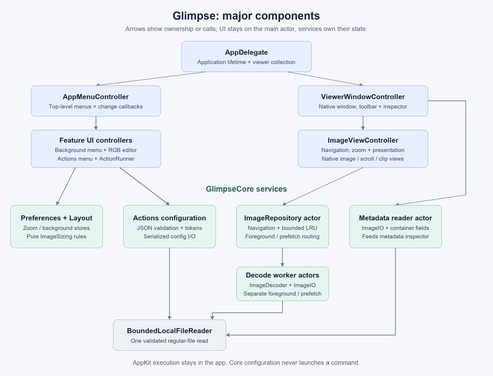

# Glimpse: architecture and repository guide

Start here to understand the app before reading individual source files. Glimpse is a programmatic AppKit image viewer: the app owns windows and user interaction; GlimpseCore owns reusable rules, configuration and image services. There is no web frontend, server, database or third-party runtime package.

## Reading order

| Guide | What it explains |
| --- | --- |
| [Repository map](repository.md) | Where source, tests, assets and build tooling live |
| [Architecture](architecture.md) | Component boundaries, state ownership and dependencies |
| [Image pipeline](image-pipeline.md) | Opening, navigating, decoding, preloading, caching and failure handling |
| [Preferences and actions](preferences-actions.md) | Persistent settings, background drawing, JSON commands and reset behavior |
| [Development and changes](development.md) | Build/test entry points and where common changes belong |

The diagrams are checked-in PNG images so they can be read offline or on GitHub; matching SVG files are in [images/](images/). Their editable source is [render_diagrams.py](render_diagrams.py). Regenerating them needs Python 3 and Pillow; neither is required to build or run Glimpse.

These specifications describe the implemented design, rather than a proposed rewrite. Keep them updated when ownership, public behavior, persistence keys or file layout changes. The audit in `docs/` is a historical review; these guides are the ongoing architecture reference.
