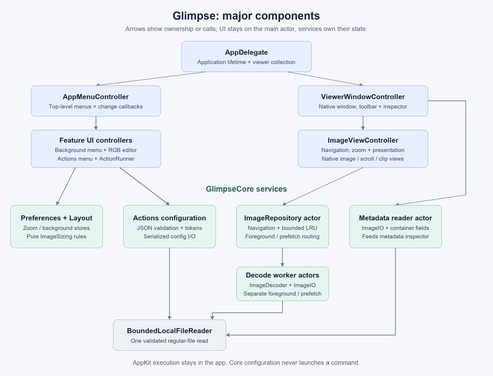

# Architecture and ownership

## Application shell

`AppDelegate` owns the viewer-window collection and the shared zoom/background preference stores. A Finder/Dock open request or File → Open creates a viewer window. Close callbacks remove controllers from the collection and cancel image work. When the last window closes, the app normally exits.

`AppMenuController` builds the top-level application, File, View, Settings, Actions and Window menus. It delegates feature-specific menu behavior to `BackgroundMenuController` and `ActionsMenuController`. Selection changes call explicit callbacks; the delegate applies changed settings to every open image window.

## Presentation

| Owner | State and responsibility |
| --- | --- |
| `ViewerWindowController` | Native window/toolbar, close lifecycle and its metadata inspector |
| `ImageViewController` | Current navigator, image dimensions, magnification, load task/request ID and presentation errors |
| `ImageContentView` | Viewport background rendering and keyboard focus |
| `CenteringClipView` | Equal gutters when the image is smaller than the viewport |
| `ZoomableScrollView` | Native magnification and modifier-scroll input |
| `MetadataWindowController` | Inspector entries, search/filter state and metadata read task |
| `CustomBackgroundWindowController` | Temporary RGB/color-picker edits; only Apply persists them |

All UI controllers/views are main-actor isolated. They render and route input; reusable geometry, directory traversal, parsing and file-reading rules belong in core. Opening metadata does not change the source image. A background change redraws the viewport and does not recolor or re-encode the image.

## Core services

| Area | Main types | Contract |
| --- | --- | --- |
| Preferences | `ZoomPreferences`, `BackgroundPreferences` | Own UserDefaults keys and safe fallbacks; accept isolated defaults stores for tests |
| Layout | `ImageSizing` | Pure finite-size/zoom calculations, no window access |
| Navigation | `FileNavigator` | Value-type sorted sibling selection with wrapping and directional neighbor suggestions |
| Imaging | `ImageRepository`, `ImageMemoryCache`, `ImageDecodeWorker`, `ImageDecoder` | Async load coordination, invalidation, bounded retention and native decoding |
| File access | `BoundedLocalFileReader` | One validated, bounded regular local-file read; reused by config, images and metadata |
| Actions | `ActionsConfiguration`, `ImageAction`, `ActionsConfigurationStore` | Decode/validate data, expand placeholders and serialize configuration I/O |
| Metadata | `ImageMetadataReader`, `ImageContainerMetadata` | Flatten ImageIO properties and inspect supported container details |

Core has no application, window or menu ownership. Imaging adapters still use Apple's AppKit/ImageIO types: core is not a portable Linux image library. Pure rules are kept separate from those adapters.

## Concurrency and object lifetime

Each viewer owns an `ImageRepository` actor, which owns its cache and two independent worker actors: foreground decode and speculative prefetch. This keeps speculative work out of the foreground queue. Results cross to the main-actor controller; cancellation and request IDs prevent an older selection from replacing a newer image.

Raster `NSImage` references are treated as immutable after decoding and drawn only by the UI. The narrowly scoped `@unchecked Sendable` wrappers encode this contract; they are not permission to mutate images across actors. Mutable animation representations are not cached/reused. The metadata reader and config store also serialize their own work through actors.

Controller-owned tasks are canceled on close. `NotificationObservation` owns a notification token and unregisters it on deallocation. Keep callback captures weak where an owner retains the callback, and avoid having background tasks retain windows for their entire duration.

## Trust boundaries

Glimpse uses hardened runtime but is not App Sandbox enabled. Native image codecs remain in-process. Encoded/pixel/frame limits reduce resource abuse but do not create process isolation. Custom commands intentionally run with the user's privileges after confirmation. Config data stays inert until the app's `ActionRunner` executes a selected action; core never launches processes. See [preferences and actions](preferences-actions.md) for the execution boundary and [image pipeline](image-pipeline.md) for resource limits.
