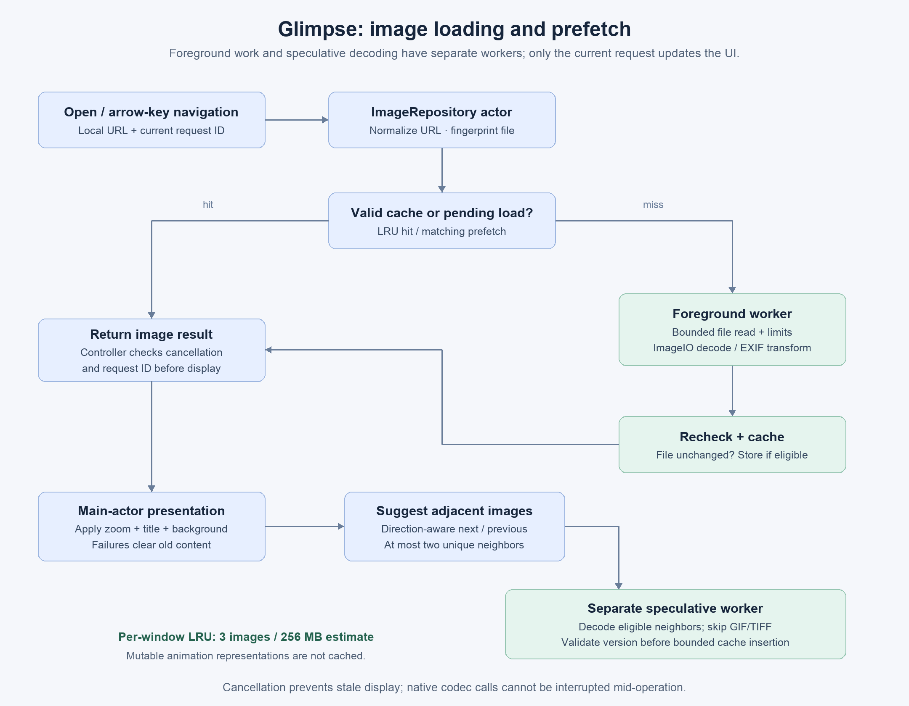

# Image opening, navigation and metadata

## From selection to display

1. Finder/Dock or the open panel provides a local file URL. The app creates a `ViewerWindowController` and calls the image controller.
2. The controller cancels its previous task, advances a request ID, clears the old image and displays a loading title.
3. `ImageRepository.load` canonicalizes the parent directory, optionally builds a navigator and reads a file-version fingerprint.
4. A valid LRU hit returns immediately. Otherwise a matching pending prefetch is promoted, or the foreground decode worker reads/decodes the image. A stale pending prefetch is canceled rather than reused.
5. `BoundedLocalFileReader` opens once, validates the descriptor as a regular local file and reads bounded chunks with cancellation checks. The decoder validates dimensions/frame counts before native pixel decoding and applies EXIF orientation where needed. Multi-frame representations are retained for animation.
6. The repository rechecks file identity before caching. The controller checks cancellation/request ID before presenting the result on the main actor.
7. The image gets its mode-specific layout; the title shows filename, folder position, dimensions and zoom. The repository starts prefetching up to two suggested neighbors.

Failures clear the old image and display an explanatory error. They do not leave stale dimensions or content onscreen. Cancellation of a native codec call is cooperative between operations; the app cannot interrupt arbitrary work inside ImageIO.

## Navigation and prefetch

`FileNavigator` lists supported regular image siblings, sorts filenames naturally and wraps left/right at the ends. It preserves an explicitly opened hidden file or an image with an unrecognized extension. Its direction determines which neighboring file gets prefetch priority. Directory membership is a snapshot at initial open; reopening refreshes it.

The per-window LRU defaults to **three images / 256 MB estimated decoded bytes**. Its fingerprint includes device, inode, size and nanosecond modification time. Ordinary edits/replacements invalidate entries; it is not a cryptographic content hash. Prefetch uses a separate worker, skips GIF/TIFF, and does not cache mutable animated representations.

Cache retention limits do not cap total process memory: the displayed image, encoded bytes, codec work buffers, in-flight work and other windows also consume memory.

## Default input limits

| Boundary | Default |
| --- | --- |
| Encoded image file | 256 MB |
| Pixels in an individual frame | 100 million |
| Estimated decoded storage per frame | 512 MB |
| Frames | 1,000 |
| Aggregate frame pixels | 200 million |

These defaults are in `ImageDecodingLimits`; tests inject smaller limits to exercise rejection without huge allocations.

## Metadata path

File → View Metadata (`⌘I`) opens a separate inspector owned by the viewer window. `ImageMetadataReader` reads container properties without raster decoding, flattens dictionaries/arrays, and supplements them with bounded PNG/JPEG/GIF container inspection. The UI filters property names and values and can copy the complete bounded report.

The inspector includes exposed EXIF, comments, compression/coding details, JPEG quantization tables and GIF palette sizes. A palette size is not a count of unique used pixel colors. An exact JPEG encoder quality percentage is not inferred from quantization tables. Vendor metadata not exposed by ImageIO may be absent.

Display limits include 16 KB per value, a 4 MB aggregate text budget, 10,000 fields, nesting depth 32 and the first 1,000 frames, with limit notices. These are separate from image raster limits. Parser tests cover truncation, malformed data and comment flooding.
