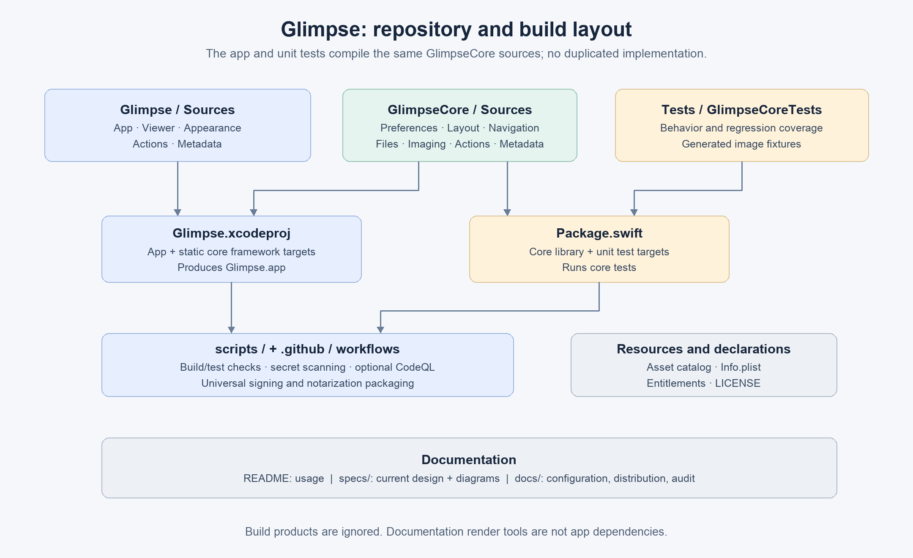

# Repository map



```text
Glimpse/
  Sources/
    App/           Entry point, app lifetime, menus, notification ownership
    Viewer/        Image window/controller, scroll/clip/image content views
    Appearance/    Background submenu, custom RGB/color picker, AppKit colors
    Actions/       Config-driven menu, native command and URL execution
    Metadata/      Searchable metadata inspector window
  Resources/       Asset catalog: app icon and accent color
  Info.plist       Bundle identity and supported image document declarations
  Glimpse.entitlements
GlimpseCore/
  Sources/
    Preferences/   Zoom/background values and injectable UserDefaults stores
    Layout/        Window size and zoom calculations
    Navigation/    Sibling image ordering and current selection
    Files/         Shared bounded local regular-file reader
    Imaging/       Formats, decoder, worker actors, repository and LRU cache
    Actions/       JSON model, validation, substitutions and config file store
    Metadata/      ImageIO metadata and PNG/JPEG/GIF container inspection
Tests/GlimpseCoreTests/  Unit/regression tests and generated image fixtures
Glimpse.xcodeproj/      App + static GlimpseCore framework targets
Package.swift          Core library + unit test targets, same core sources
scripts/               Checks, scanner installer and release packaging
tools/                 Pinned development scanner version/checksums
.github/workflows/     Builds/tests, secret scan and optional CodeQL
specs/                 This architecture guide and its diagram images
docs/                  Actions instructions, distribution and historical audit
README.md              User-facing overview and build/usage quick start
SECURITY.md            Trust boundaries and security checks
LICENSE                Declared GPLv3 license text
```

## The two build descriptions

[The Xcode project](../Glimpse.xcodeproj/project.pbxproj) builds the executable app and links GlimpseCore as a **static framework**. The framework is an organizational/build boundary; it is not a separate process or service.

[Package.swift](../Package.swift) points to the **same** `GlimpseCore/Sources` directory and adds the test target. It provides a lightweight way to test core independently of application startup. It does not build the AppKit app. Do not create duplicate core implementations for SwiftPM and Xcode.

New Swift files must be included in the appropriate Xcode target and group. SwiftPM discovers files beneath its configured source/test paths automatically. The original `Base.xcconfig`/`LocalDev.xcconfig.template` are legacy scaffolding; use the checked-in scripts and explicit build flags as the authoritative command-line workflows.

## Where to begin reading code

1. [main.swift](../Glimpse/Sources/App/main.swift) creates the application and delegate.
2. [AppDelegate](../Glimpse/Sources/App/AppDelegate.swift) creates menus and viewer windows.
3. [ViewerWindowController](../Glimpse/Sources/Viewer/ViewerWindowController.swift) creates the window, toolbar and image controller.
4. [ImageViewController](../Glimpse/Sources/Viewer/ImageViewController.swift) connects user input to [ImageRepository](../GlimpseCore/Sources/Imaging/ImageRepository.swift) and presents results.

Root-level loose image files are not the authoritative app icon. The shipping icon is in the asset catalog; `docs/icon.png` is the README artwork. Build products belong in ignored `build/` or external DerivedData directories, not under source folders.
